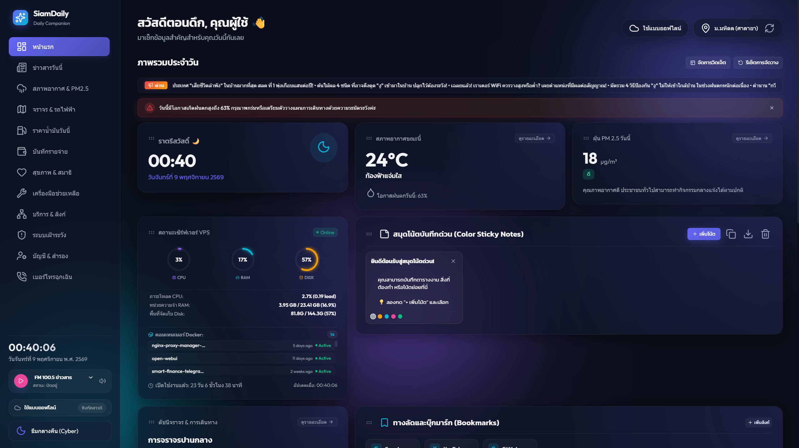
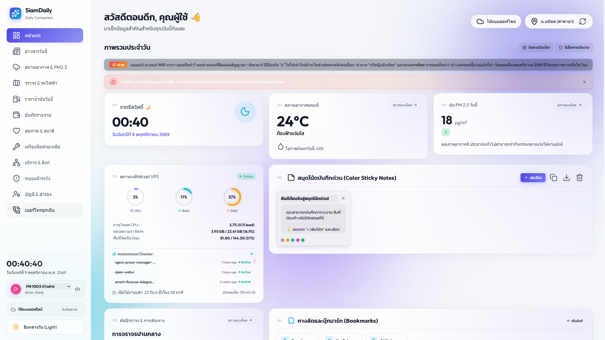
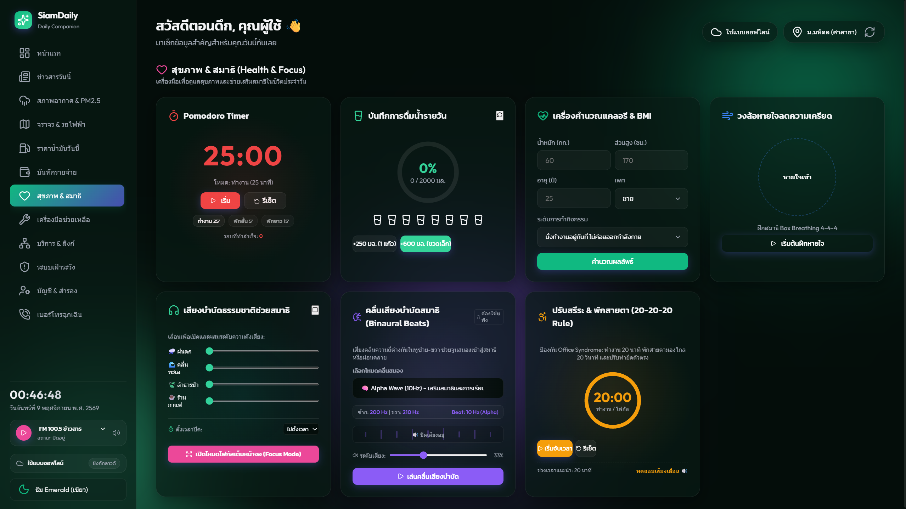
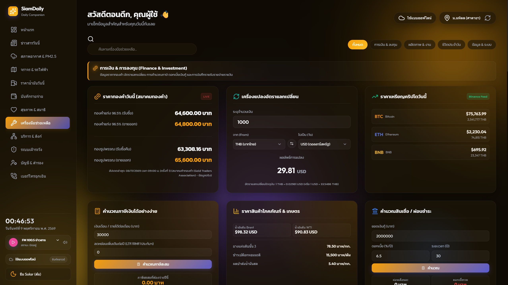
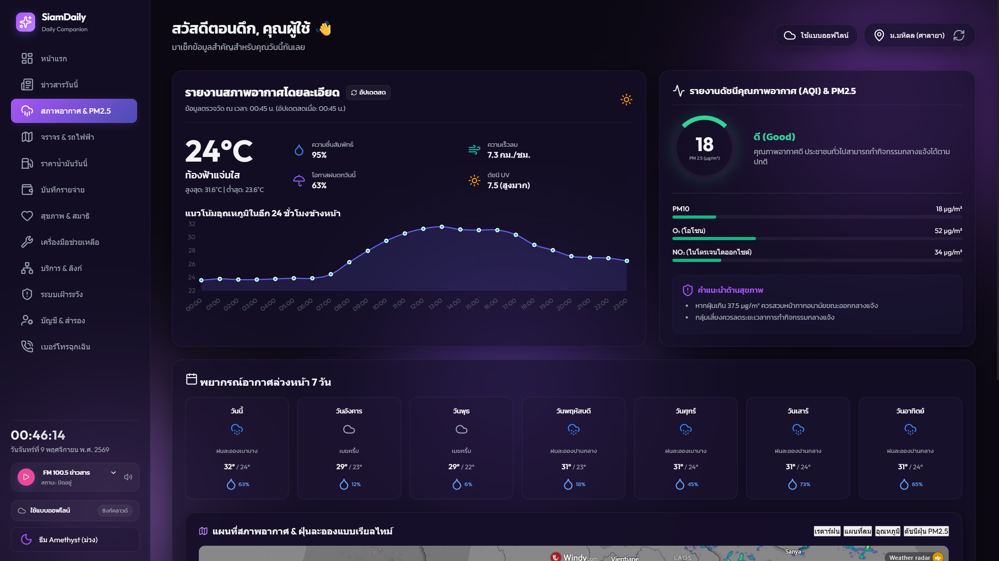
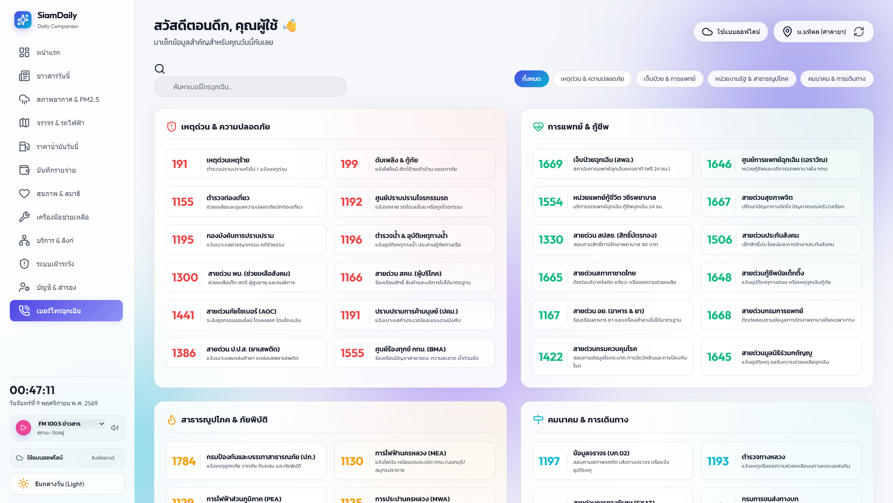

# SiamDaily — Daily Companion

> A modern, fully self-hosted daily utilities dashboard built for Thailand.
> แดชบอร์ดผู้ช่วยสำหรับคนใช้ทุกวัน — one URL for your weather, dust (PM2.5), transit, oil prices, news, personal finance, health tracking, home-server monitoring, and a live SSH security auditor.





---

## ✨ Features at a glance

| Area | Highlights |
|---|---|
| 🗓️ **Dashboard** | Time-of-day greeting & clock, weather brief, PM2.5 safety banner, live traffic status, VPS CPU/RAM/Disk gauges, Docker container list, multi-color sticky notes, breaking-news ticker, to-do checklist, 105-day habit grid, mini expense tracker, gold & crypto widget, Pomodoro widget, live radio player + audio visualizer |
| 🌦️ **Weather & PM2.5** | Hourly temperature chart, live PM2.5 / PM10 / O₃ / NO₂ air-quality ring with health advice, 7-day forecast, interactive Windy radar / wind / temperature / AQI maps |
| 🚇 **Traffic** | BTS / MRT / Airport Rail Link fare & transfer calculator (BFS shortest-path routing), live map embed |
| ⛽ **Oil & Gold** | Live Bangchak & PTT retail fuel prices, live Thai Gold Association bar / jewelry prices with fallback sources |
| 📰 **News** | Real-time Thai RSS feed aggregation (Sanook), category filtering, full-text search, and user-defined custom feeds |
| 💰 **Finance & Investment** | Live gold prices, multi-currency converter, live Binance crypto rates (BTC/ETH/BNB/SOL), income-tax calculator (LTF/RMF deductions), commodity & agricultural prices (Brent/WTI/rubber/rice/palm), mortgage & loan calculators |
| 🧮 **Productivity tools** | JSON formatter & validator, epoch / Unix-time converter, text & encoding helper (case / URL / Base64), world clock |
| 🎨 **Lifestyle tools** | Wallpaper engine (mesh gradients, presets, custom URL), random food picker, password generator, electricity-bill estimator, unit converter (distance / weight / temperature / Thai land area), QR code generator (incl. PromptPay) |
| 📡 **Data, systems & fun** | Thai lottery checker, national holiday calendar, satellite weather by custom coordinates, random-number generator, daily tarot card, internet & VPS speedtest + ISP diagnostic, network diagnostics terminal (ping / DNS / port check), Snake & 15-Puzzle mini-games |
| ❤️ **Health & Focus** | Pomodoro timer, water-intake tracker, BMI calculator, Box-breathing guide, ambient audio mixer, binaural beats, 20-20-20 eye-strain timer |
| 📊 **Budget** | Category-based income/expense logging with progress bars and percentage analytics |
| 🔗 **Services & Links** | Personal bookmark / self-hosted-app launcher with categories, search, add / edit / delete, and custom image logos (cloud-synced) |
| 📞 **Emergency** | Curated Thai emergency & service numbers (police, fire, medical, utilities, banks) with category filter & search |
| 🛡️ **Monitoring & Security** | Live SSH brute-force auditor (failed-login map + accurate per-day & total counts), web-scraping alert bot (Discord / LINE / Telegram), VPS hardware & Docker control panel |
| 👤 **Account & Backup** | Cloud-sync status, personal profile notes, one-click JSON export / import backup, change password, active-session manager with remote revocation, and app login history |
| 📱 **PWA & UX** | Installable + offline-cached (service worker), command palette (`⌘K` / `Ctrl+K`), 5 color themes (Cyber, Light, Amethyst, Emerald, Solar), mobile bottom-navigation & slide-up sheet |


---

## 📸 Screenshots

| | |
|---|---|
| **Health & Focus** (Emerald) | **Finance & Investment** (Solar) |
|  |  |
| **Weather & PM2.5** (Amethyst) | **Emergency contacts** (Light) |
|  |  |

Five built-in themes: **Cyber (Dark) · Light · Amethyst · Emerald · Solar** — toggle anytime from the sidebar.

---

## 🧰 What makes it tick

**Real-world, live data** — The backend proxies and normalizes many public/Thai APIs behind clean `/api/*` routes so the frontend stays simple and resilient to upstream outages:

- **Weather & air quality** — [Open-Meteo](https://open-meteo.com) forecast + air-quality (`pm2_5`, `pm10`, `ozone`, `nitrogen_dioxide`), [Windy](https://www.windy.com) radar/AQI overlays
- **Gold** — Thai Gold Association (scraped, with a public-API fallback and an offline mock)
- **Fuel** — Bangchak JSON + PTT SOAP endpoints
- **Crypto** — Binance 24h ticker (single batched request for BTC/ETH/BNB/SOL)
- **News** — Sanook RSS feeds, polled in the background every 10 minutes and served from cache (with per-user custom feeds)
- **System** — host CPU/RAM/disk (`os`, `df`), running Docker containers (`docker ps`)

**Personal cloud sync** — A built-in login/registration system (JSON-file datastore, **PBKDF2** password hashing) lets you sync your dashboard state (sticky notes, budget logs, todos, layout, wallpaper, habits, bookmarks) across devices. Supports **up to 10 concurrent device sessions**, remote session revocation, password change, and a **login audit trail**.

**Home-lab monitoring & security auditor** — Reads the host `auth.log`, geolocates failed SSH attempts with a persistent IP cache, and renders them on a Leaflet map. Includes accurate per-day and total failure counts, plus a **web-scraping alert bot** that watches any page for CSS-selector changes and fires Discord / LINE / Telegram notifications.

---

## 🛠️ Tech stack

**Frontend** (zero build step, no framework)
- Vanilla HTML5 / CSS3 / JavaScript (ES6 modules)
- PWA: service worker + web manifest
- Leaflet.js (maps), Lucide Icons (re-instantiated on tab change)
- Server-side view assembly — each tab is its own `.html` view file that Express injects into the shell for fast, state-preserving navigation

**Backend**
- Node.js + Express (static serving, API proxy, auth, monitoring)
- Docker / Docker Compose (single container, `node:20-alpine`)

---

## 🏗️ Architecture

```
public/index.html  (11 KB shell)          ──  server.js (Express)
   ├── views/*.html   (12 tab views)  ──▶    │  · assembles all views into the shell on request
   └── components/*.js (service classes)      │  · proxies /api/* to external + Thai sources
                                                │  · serves static assets from public/
   app.js (AppCoordinator: tabs, clock, theme, │  · auth + JSON datastore (data/users.json)
   command palette, PWA backup/restore)        │  · background pollers (news, scrapers)
                                                └  · security hardening (below)
```

The frontend is a **single-page** app: `app.js` handles tab switching by toggling the `active` class on pre-injected view containers, so all component state and event bindings survive navigation.

---

## 🔐 Security

The backend is hardened for public deployments:

- **Helmet** secure HTTP headers + **`express-rate-limit`** (per-IP) on all `/api/` routes
- **CORS** restricted to same-origin hosts
- **SSRF protection** — DNS pre-flight resolution, private-subnet / link-local / metadata-IP blocking, and DNS-rebinding guards on every outbound proxy (images, radio, services, scrapers)
- **Stored-XSS mitigation** — user-driven content (bookmarks, todos) is HTML-escaped; news rendering uses DOM text assignment
- **Prototype-pollution defense** — `hasOwnProperty`-guarded datastore lookups + reserved-username blocklist
- **Safe process execution** — `execFile` (no shell string interpolation) for `ping`/`dns`/`df`/`docker`
- **Resource-exhaustion limits** — async buffer generation for the speedtest download, stream-based 25MB upload cap, client-abort listeners, and global exception handlers
- **Auth** — PBKDF2 (100k iterations, SHA-512) hashing with transparent upgrade from legacy SHA-256, atomic datastore writes, capped concurrent sessions
- **Admin registration lockdown** — toggle signups or require a registration key via env vars

> ⚠️ **Note on the Docker socket mount**: `docker-compose.yml` mounts `/var/run/docker.sock` **read-only (`:ro`)** and it is used *only* to run `docker ps` for the VPS Control Panel. No route forwards arbitrary Docker API commands, and it is not required for core features — remove it if you don't need the control panel. (Mounting the socket is still a root-equivalent vector if the container is ever compromised, so treat it as host-trusted.)

---

## 🚀 Getting started

### Prerequisites
- **Node.js ≥ 18** (or Docker)
- For the SSH auditor, a host with an `auth.log` you can bind into the container

### Run locally
```bash
git clone <this-repo>
cd SiamDaily
npm install
npm start            # → http://localhost:8000
```

### Run with Docker
```bash
docker compose up -d --build
# → http://localhost:8000
```
The container persists the JSON datastore at `./data` and (optionally) binds the host `auth.log` for the security auditor.

### Deploy
Copy `deploy.example.sh` to `deploy.sh`, fill in your server's user/host/path, then:
```bash
./deploy.sh          # rsyncs code, then docker compose up -d --build
```

---

## ⚙️ Configuration

| Variable | Default | Description |
|---|---|---|
| `PORT` | `8000` | HTTP port the Express server listens on |
| `NODE_ENV` | `production` | Node environment |
| `REGISTRATION_OPEN` | `true` | Set `false` to block new signups |
| `REGISTRATION_KEY` | _(empty)_ | If non-empty, new signups must supply this key |

---

## 📚 API

The backend exposes 30+ documented endpoints (auth, gold, oil, news, crypto, commodities, holidays, weather proxy, diagnostics, speedtest, radio, security logs, scrapers). Full request/response schemas live in [**`docs/api.md`**](docs/api.md).

---

## 📂 Project structure

```text
├── Dockerfile                  # node:20-alpine + docker-cli
├── docker-compose.yml          # ports, env, volumes, healthcheck
├── deploy.example.sh           # one-click deploy template (fill in your server)
├── server.js                   # Express backend: API proxy + auth + monitoring
├── docs/
│   ├── api.md                  # full endpoint documentation
│   ├── architecture.md         # how the app fits together
│   ├── security.md             # every hardening measure, explained
│   ├── deployment.md           # local + Docker + server deploy guide
│   └── development.md          # how to add tabs & endpoints
├── .prettierrc                 # formatting (4-space, single quotes)
├── data/                       # JSON datastore (git-ignored; persisted via Docker volume)
│   └── users.json
└── public/
    ├── index.html              # app shell (sidebar, header, empty view containers)
    ├── style.css               # design system + all component styles
    ├── app.js                  # AppCoordinator (tabs, clock, theme, GPS, backup, palette)
    ├── sw.js / manifest.json   # PWA
    ├── views/                  # one .html per tab (assembled server-side)
    └── components/             # ES6 service classes (weather, traffic, news, finance, …)
```

---

## 🤝 Contributing

Small, incremental commits are encouraged. Before touching a backend route, read [`docs/api.md`](docs/api.md) and [`docs/security.md`](docs/security.md); before editing a tab, open its view file under `public/views/` and see [`docs/development.md`](docs/development.md). Rebuild and redeploy after changes (Docker bakes files in at build time).

---

## 📄 License

Released under the **ISC License** — see [LICENSE](LICENSE).
